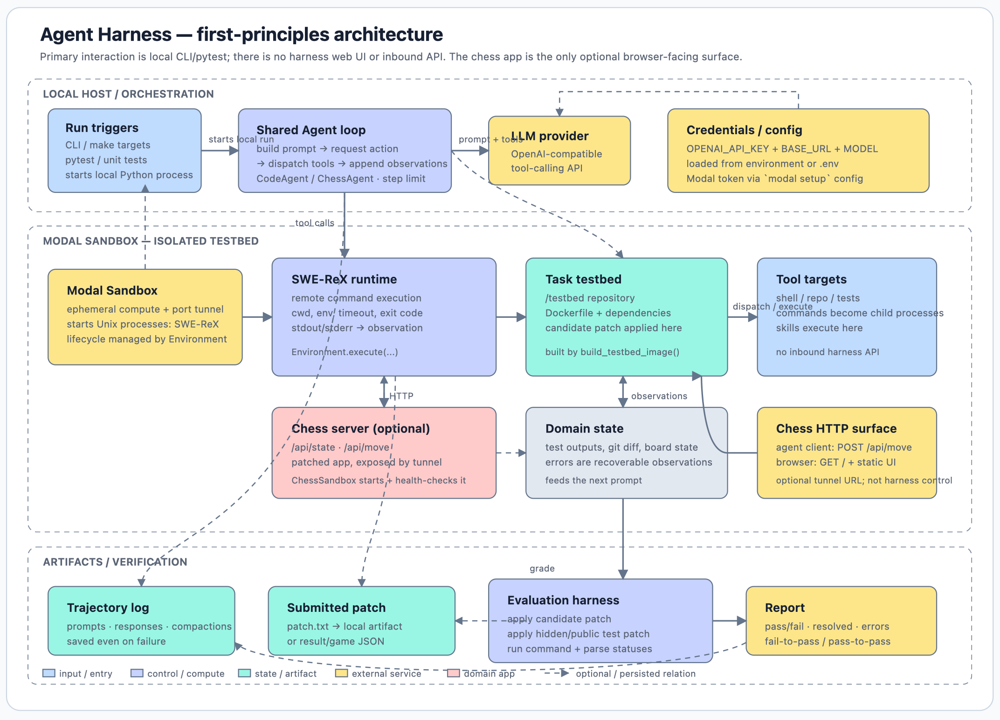

# Running the Agent Harness

This repository is a command-line harness, not an interactive chat server. A
run starts a local Python process, which calls an OpenAI-compatible LLM API and
usually creates an isolated Modal sandbox for tool execution.

## System diagram



For the zoomable standalone version, open
[harness-system-architecture.html](docs/harness-system-architecture.html).

The important boundary is:

```text
CLI / pytest
    -> local Python agent process
        -> OpenAI-compatible LLM API
        -> Modal sandbox / SWE-ReX runtime
            -> shell commands, repository, tests, or chess server
        <- tool observations
    <- trajectory, patch, result, or evaluation report
```

## Prerequisites

From the repository root:

```bash
cd /Users/ly232/github/cmu-11-768-agent-harness-assignment-1
uv sync
git submodule update --init
```

For Modal-backed runs, authenticate Modal once:

```bash
uv run modal setup
```

Configure the model provider in the shell or in a local `.env` file. Do not
commit `.env` or API keys:

```bash
source ~/.zshrc
export OPENAI_BASE_URL="https://api.openai.com/v1"
export OPENAI_API_KEY=$OPENAI_API_KEY
export OPENAI_MODEL="gpt-4o-mini"
export OPENAI_MAX_RETRIES=5

uv run assignment-doctor
make run-code-agent
```

Then start harness including Modal sandbox:

```bash
make run-code-agent MODEL=gpt-4o-mini STEPS=10
```

Inspect vm fs:

```
uv run modal shell sb-ijp4PZ5MtFndgcRE6p7dU0
```

The starter sends `reasoning_effort="medium"` with each Chat Completions
request. `gpt-4o-mini` rejects that argument. Although `gpt-5.6-luna` supports
reasoning, OpenAI currently rejects the combination of `reasoning_effort` and
function tools for that model on `/v1/chat/completions`.

For the current harness, this command still requires changing
`reasoning_effort="medium"` in `src/assignment/agent/base.py` to
`reasoning_effort="none"` for the Luna + function-tools combination. The
other option is to refactor the agent request to the Responses API, which
supports reasoning and tools together but requires changing response parsing.
Similarly, `gpt-4o-mini` can be used after omitting `reasoning_effort`.

### What `reasoning_effort` means

`reasoning_effort` is a model-dependent inference-budget setting. It influences
how much internal reasoning the model may use before producing its answer; it
does not expose chain-of-thought and is not a requirement for an agent loop.
The model can still make multiple tool calls across multiple harness steps
without this setting.

It is not universally supported or universally compatible with tools. In this
repository, the request is made through Chat Completions with function tools.
For the OpenAI configuration above, keeping `medium` requires migrating that
request to the Responses API and adapting tool-call/response parsing. Using
`none` or omitting the parameter is the minimal compatibility path.

Check configuration without starting a sandbox:

```bash
uv run assignment-doctor --offline
```

Run the full configuration check, including a request to the provider's
`/models` endpoint:

```bash
uv run assignment-doctor
```

## Fast local checks

The default test command is offline and does not launch Modal:

```bash
uv run pytest
# or
make test
```

These tests exercise the agent loop, prompt construction, tool dispatch, and
local fakes/mocks. They are the closest thing to a local harness simulation,
but they do not send real prompts to an LLM unless a test explicitly does so.

The real Modal integration tests are opt-in and may consume credits:

```bash
uv run pytest -m modal
# or
make test-modal
```

## Start a coding-agent run

The coding agent receives its task prompt from the task directory's
`problem_statement.md`. The default task is
`tasks/chess-terminal-move`.

```bash
uv run assignment-code-agent \
  --task tasks/chess-terminal-move \
  --model "$OPENAI_MODEL" \
  --step-limit 100 \
  --trajectory artifacts/part1-trajectory.json \
  --patch-output artifacts/fix.patch
```

Equivalent Make target:

```bash
make run-code-agent
```

During this run:

1. The local CLI starts a Python process.
2. `Environment` creates a Modal sandbox and connects to its SWE-ReX runtime.
3. The agent sends the task prompt and tool definitions to the LLM API.
4. The LLM returns tool calls such as `execute`.
5. The local agent dispatches those calls into the remote sandbox.
6. Command output is returned as a tool observation for the next prompt.
7. The agent writes `patch.txt` in the sandbox; the CLI saves it locally.

The trajectory JSON records prompts, model responses, and context-compaction
events. The patch is the agent's normal output.

### Bounded 10-step smoke run

Use a small step limit to verify that credentials, the LLM endpoint, Modal, and
SWE-ReX can all be reached without letting the agent run for a full task:

```bash
make run-code-agent MODEL=gpt-4o-mini STEPS=10
```

If the agent has not finished by step 10, the harness intentionally raises
`StepLimitError` and exits nonzero. That is an expected bounded-run result,
not evidence that Modal or the LLM failed. A healthy smoke run shows:

```text
Starting Modal sandbox
Starting SWE-ReX runtime
[agent] step 1/10: requesting action
...
[agent] step 10/10: requesting action
StepLimitError: Agent exceeded step limit of 10
```

This demonstrates infrastructure and model connectivity, but it is not a
successful task completion. A completed task must finish before the limit and
produce the requested patch artifact. If every step says `response contained
no parsed tool call`, the model returned no executable action; inspect the
trajectory and model/tool compatibility rather than treating that as a patch
success.

## Intermediate results and storage

There are two places to distinguish:

- Local runner: `artifacts/part1-trajectory.json` stores the prompts sent to the
  model, model responses, and compaction events. Tool observations are included
  in the subsequent prompts. This is the main durable intermediate record.
- Modal sandbox: `/testbed`, `patch.txt`, command output, and runtime files live
  in the temporary remote sandbox while the run is active. `Environment.execute`
  returns command output to the local runner; it does not automatically copy
  the remote filesystem to the laptop.

On a completed coding-agent run, the CLI explicitly reads `/testbed/patch.txt`
before the context manager closes and saves it locally as the path passed to
`--patch-output`, for example `artifacts/fix.patch`. On a step-limit or other
failed run, that copy step may not happen, but the trajectory is still written
by the agent's cleanup block.

The sandbox is normally terminated automatically after the run. Once it is
terminated, remote intermediate files are no longer an access path. Modal's
dashboard URL printed at startup is useful for runtime logs, not for browsing
the `/testbed` filesystem. To preserve additional remote files, add an
explicit `Environment.execute("cat ...")`/copy step before shutdown and write
the result to a local artifact.

### Inspecting a live Modal sandbox

While a sandbox is still running, the Modal CLI can open a shell by sandbox ID.
The ID is printed near the beginning of a run, for example
`sb-ijp4PZ5MtFndgcRE6p7dU0`:

```bash
uv run modal shell sb-ijp4PZ5MtFndgcRE6p7dU0
cd /testbed
find . -maxdepth 2 -type f | sort
cat patch.txt
```

From another terminal, first list live containers if needed:

```bash
uv run modal container list
uv run modal container exec sb-ijp4PZ5MtFndgcRE6p7dU0 -- \
  bash -lc 'cd /testbed && git status --short && find . -maxdepth 2 -type f | sort'
```

`uv run modal dashboard` opens the Modal web dashboard for app metadata and
logs, but the CLI shell/exec commands are the filesystem interface. This
repository stops the sandbox automatically when the agent exits, including on
step-limit and error paths, so connect while the run is active or add an
explicit copy/inspection step before shutdown. A terminated sandbox cannot be
browsed afterward.

### Where agent-written code lives

The LLM does not execute code and does not write directly to the laptop. The
local Python process orchestrates the run, but the agent's `execute` tool calls
are sent through SWE-ReX into the remote Modal sandbox:

```text
LLM proposes execute(command)
  -> local CodeAgent dispatcher
  -> Environment.execute(...)
  -> SWE-ReX runtime in Modal
  -> shell process modifies /testbed and runs tests
  <- stdout/stderr/exit code returned as a tool observation
```

For example, a model-generated command such as
`cat <<'EOF' > src/fix.py ... EOF` creates `src/fix.py` inside the remote
`/testbed`. A later `pytest` command runs there against that modified checkout.
The local runner receives only the command result and records it in the
trajectory. At the end of a successful coding run, the CLI explicitly reads
`/testbed/patch.txt` through the same remote execution channel and writes the
contents to the local `--patch-output` path.

In the 10-step trajectory currently committed, there were no parsed tool calls,
so the agent did not write or execute any code in the sandbox at all.

## How to send a prompt

There is no `stdin` chat loop or general `/run` API. The initial user prompt is
the task's problem statement. To send a different coding prompt, edit or create
the task's `problem_statement.md`, then run the CLI with that task directory.
The task directory must also provide a compatible `task.json`, source checkout,
and Dockerfile because the sandbox image is built from the task.

For a quick variation of the bundled task, make a copy outside git-tracked
files, edit its `problem_statement.md`, and pass that directory with `--task`:

```bash
cp -R tasks/chess-terminal-move /tmp/my-agent-task
$EDITOR /tmp/my-agent-task/problem_statement.md

uv run assignment-code-agent \
  --task /tmp/my-agent-task \
  --model "$OPENAI_MODEL" \
  --trajectory artifacts/custom-trajectory.json \
  --patch-output artifacts/custom.patch
```

The model receives the task statement as the initial `user` message. Later
messages are generated by the agent loop: assistant tool calls followed by
observations from the sandbox.

## Evaluate the generated patch

Run the public evaluation against a fresh testbed:

```bash
uv run python scripts/evaluate.py \
  --task tasks/chess-terminal-move \
  --evaluation tasks/chess-terminal-move/public_tests \
  --patch artifacts/fix.patch \
  --verbose
```

Or:

```bash
make check-part1 PATCH=artifacts/fix.patch
```

The evaluator applies the candidate patch first, applies the evaluation test
patch second, runs the configured test command, parses test statuses, and
prints the final report.

## Start the chess agent

The chess agent's prompt is generated by `ChessAgent`: it contains the system
instructions plus the current board state. It is not supplied interactively on
stdin. The agent acts through `play_move`, and optionally `simulate_move` and
`run_python`.

First generate a coding-agent patch, then run:

```bash
uv run assignment-play-chess \
  --task tasks/chess-terminal-move \
  --patch artifacts/fix.patch \
  --model "$OPENAI_MODEL" \
  --step-limit 200 \
  --trajectory artifacts/part3-trajectory.json \
  --result artifacts/game-result.json
```

Equivalent Make target:

```bash
make run-chess-agent \
  PATCH=artifacts/fix.patch \
  TRAJECTORY=artifacts/part3-trajectory.json \
  RESULT=artifacts/game-result.json
```

This starts a patched chess server inside the Modal sandbox. The server has:

- browser UI: `GET /`
- game state: `GET /api/state`
- move action: `POST /api/move`
- reset: `POST /api/reset`
- simulation: `POST /api/simulate`

The CLI prints the tunneled server URL. Open that URL in a browser to interact
with the chess app as a human. The browser UI is an app-level interface, not a
general interface for starting or controlling the agent harness.

To start only the sandbox chess server without the LLM agent:

```bash
uv run assignment-chess-modal \
  --task tasks/chess-terminal-move \
  --patch artifacts/fix.patch
```

## SWE-bench mode

The same coding-agent loop can run against a published SWE-bench image:

```bash
uv run assignment-swebench-agent django__django-15368 \
  --model "$OPENAI_MODEL" \
  --trajectory artifacts/django-trajectory.json \
  --patch-output artifacts/django.patch
```

Then evaluate it:

```bash
make check-swebench \
  INSTANCE=django__django-15368 \
  SWEBENCH_PATCH=artifacts/django.patch
```

## Troubleshooting authentication

If the run creates a Modal sandbox but fails on step 1 with `401
AuthenticationError`, Modal is working; the LLM provider rejected
`OPENAI_API_KEY`.

The agent calls `load_dotenv()` without overriding existing environment
variables. An old `OPENAI_API_KEY` exported in the shell therefore takes
precedence over the value in `.env`. Refresh all provider settings in the same
terminal before retrying:

```bash
unset OPENAI_API_KEY OPENAI_BASE_URL OPENAI_MODEL OPENAI_MAX_RETRIES
set -a
source .env
set +a
export OPENAI_API_KEY="$DEEPSEEK_API_KEY"

uv run assignment-doctor --offline
make run-code-agent
```

Alternatively, export the three provider settings explicitly with a valid key
from the provider named by `OPENAI_BASE_URL`. Do not paste API keys into logs,
source files, or chat. Run `assignment-doctor --offline` first: it validates
the local configuration without launching a Modal sandbox or calling the LLM.

If the run instead fails with HTTP `402` and `Insufficient Balance`,
authentication is working but the provider account has no available inference
credit. Add credit/enable billing in the DeepSeek account, or configure a
different OpenAI-compatible provider and matching key. This error cannot be
fixed by changing Modal or the harness code.

If the DeepSeek dashboard shows a positive balance, verify that the same API
key sees that balance and that the endpoint/model pairing is correct. Do not
paste the output or key into chat:

```bash
curl -sS "${OPENAI_BASE_URL%/v1}/user/balance" \
  -H "Authorization: Bearer $OPENAI_API_KEY"
```

For the native DeepSeek API, use the exact model name advertised by its `/models`
endpoint, commonly `deepseek-chat` or `deepseek-reasoner`. A name such as
`deepseek/deepseek-v4-flash-0731` may belong to an aggregator rather than the
native DeepSeek endpoint; in that case use the aggregator's base URL and key.

## Outputs and cleanup

Typical outputs are:

- `artifacts/*-trajectory.json`: prompts, responses, and compaction events
- `artifacts/*.patch`: patches submitted by the coding agent
- `artifacts/game-result.json`: final chess state
- evaluation output: pass/fail report printed by the evaluator

Runs normally stop their sandbox in a `finally`/context-manager cleanup path.
If a process is interrupted and a sandbox remains alive, inspect and stop it:

```bash
uv run modal container list
uv run modal container stop <container-id>
```
